# FGO icon visual identity, and the icon grammar for Fate/Grail Tactics

Every ability and effect in this system gets its own picture. The picture sits in the art slot the
Grail War Nocturne redesign already built: the skill row's diamond gem, the action bar's cut tile, and
the effect's metal frame (`DESIGN.md`, *Effects* and *Skill Rows*). This file studies how Fate/Grand
Order draws the same things. It then sets the rules that the **Icon family** and **Icon concept**
columns of the Codex follow. The Codex is in `docs/design/codex/`, and the Google Sheet is built from
it.

**Sample.** 30 icons, pulled from the Atlas Academy API
(`https://api.atlasacademy.io/nice/NA/servant/{id}`). Each one's name comes from the skill or buff
that uses it, not from a guess:

- **16 skill icons**, `static.atlasacademy.io/NA/SkillIcons/skill_NNNNN.png`, at 110×110.
- **14 status icons**, `.../BuffIcons/bufficon_NNN.png`, at 44×44.

The files are in [`fgo-icons/`](fgo-icons/). I read 19 Servants' kits to name them:
- Altria, Medusa, Cú Chulainn, Heracles, Karna, Medea, Hassan of the Cursed Arm, Jack, Gilgamesh
- Ozymandias, Raikou, Scáthach, Nightingale, Mash, Morgan, Arjuna Alter, Kama, Altria Caster, Okuni
- Jeanne Alter, Dantès, Robin Hood, Kiyohime and Tamamo Cat, for the debuffs

## The 30

### Skill icons (110px, framed)

| Icon | Used by (sample) | Subject | Ground | Overlay | Reads at 24px? |
|---|---|---|---|---|---|
| 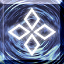 `skill_00100` | Magic Resistance (every rank, every Servant) | white lattice of four diamonds, a ward rune | swirling blue vortex | none | yes: a white cross on blue |
| 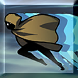 `skill_00101` | Independent Action | cloaked figure sprinting out of frame | pale teal with speed streaks | none | partly: reads as "a figure moving" |
| 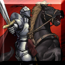 `skill_00102` | Riding | armoured knight on a black horse | red-grey painted sky | none | no: the horse becomes noise |
|  `skill_00103` | Item Construction | round flask of green liquid | flat violet | none | yes: green on purple |
| 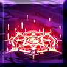 `skill_00104` | Territory Creation | red magic circle glowing on a floor | deep violet | none | partly: a red smudge |
|  `skill_00105` | Presence Concealment | blank white mask dissolving in smoke | grey fog | none | partly: a pale face in grey |
| 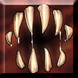 `skill_00106` | Mad Enhancement | a ring of fangs, a maw seen from inside | blood brown | none | yes: teeth |
| 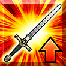 `skill_00300` | Charisma, Valor, Monstrous Strength, Divine King of the Burning Sands, Anti-Evil, Charisma of Hope | a longsword on the diagonal | red-orange-gold sunburst | orange **up-arrow** | yes |
|  `skill_00306` | Mana Burst (any element), Dragon's Core, Angel's Cry, Thunder God's Manifestation, Bunker Bolt | shattered "impact" shards, a comic-book hit | sunburst | orange up-arrow | yes |
| 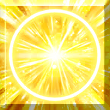 `skill_00326` | Divinity | a radiant sun disc | pure gold | none | yes: the brightest icon in the set |
| 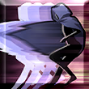 `skill_00402` | Protection from Arrows, Mind's Eye (Fake), Murder on a Misty Night, Wisdom of Dún Scáith | hooded figure ducking, motion-blurred | violet-grey | none | partly |
| 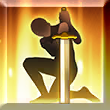 `skill_00404` | Battle Continuation, Ath nGabla, Indefatigable, Soul's Light, Ananga, From the World's End | a figure kneeling and leaning on a planted sword | golden backlight | none | yes: the silhouette is iconic |
| 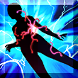 `skill_00508` | Mystic Eyes (Medusa's petrify) | a body frozen mid-step, cracked by red lightning | electric blue | none | yes |
| 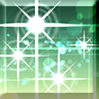 `skill_00600` | Argon Coin, Surgery, Nurse of Steel, Imperial Privilege | scattered white-green sparkles | teal-green | none | yes: green means heal |
| 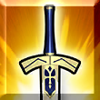 `skill_00601` | Shining Path, Blood Fort Andromeda, Rapid Words of Divine, Protection of the Lake, Mara Pāpīyas | a sword pointing down, an Excalibur-like hilt | gold | none | yes |
|  `skill_00700` | Mash only: Shield of Rousing Resolution, Amalgam Goad | a red crosshair reticle | sunburst | up-arrow | yes |

### Status icons (44px, frameless)

| Icon | Status | Glyph | Colour | Polarity mark | Reads at 24px? |
|---|---|---|---|---|---|
|  `300` | ATK Up | sword | orange | orange **up-arrow** | yes |
|  `301` | DEF Up, Damage Cut | heater shield | orange | up-arrow | yes |
|  `304` | Guts | the kneeling figure from `skill_00404`, flattened | gold | none | yes |
|  `305` | Evade | the dashing figure, flattened | gold with a motion smear | none | yes |
|  `306` | Debuff Resist Up, Mental Resist Up | hooded praying figure | orange | up-arrow | yes |
|  `311` | Invincible | heater shield with a cross | gold and brown | none | yes |
|  `323` | Target Focus (taunt) | white crosshair | white | up-arrow | yes |
|  `500` | Poison | rising bubbles | violet | none | yes |
|  `501` | **Stun and Petrify, the same icon** | a jagged "shock" outline | yellow | none | yes |
|  `502` | Charm | a heart | pink | none | yes |
|  `504` | DEF Down | the DEF Up shield, recoloured | blue | blue **down-arrow** | yes |
|  `512` | NP Seal | a sword struck through by an X | orange-red | none | yes |
|  `513` | Burn | a slab of flame | red-orange-yellow | none | yes |
| 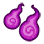 `521` | Curse | two curling wisps | violet | none | yes |

## What the sample shows

1. **There are two tiers, and they are drawn differently.**
   - A **skill icon** is a painted square scene in a thin bevelled chrome frame, built to be read at
     full size in a menu.
   - A **status icon** is a flat glyph with a thick black outline and no background, built to be
     read in a row of 12 under a health bar.
   - The same idea appears in both tiers. Guts is a kneeling swordsman as a skill (`00404`) and as a
     status (`304`). Evade is the same dashing figure in both. The status icon is the skill's
     subject with everything else stripped away.
2. **FGO draws the effect, not the skill.**
   - Charisma, Valor, Monstrous Strength and Anti-Evil all wear `skill_00300`, because all of them
     raise ATK.
   - Mana Burst, Dragon's Core and Bunker Bolt all wear `skill_00306`.
   - Across the 14 Servants' kits, about 95 skills used only 22 distinct icons.
   - Only Mash (`00700`) and Okuni (`00316`, `00609`) showed one outside the shared pool.
   - Uniqueness lives in the name and the animation, not the icon.
3. **Class skills are emblems, not effects.** The `001xx` row (Magic Resistance, Riding, Independent
   Action, Item Construction, Territory Creation, Presence Concealment, Mad Enhancement) is figurative
   and dark-grounded, with no arrows. It says *who you are*, not *what number changed*.
4. **An arrow is the whole polarity language.**
   - An orange up-arrow in the corner means *more*.
   - A blue down-arrow means *less*.
   - The silhouette underneath stays the same: DEF Up `301` and DEF Down `504` are one shield in two
     colours.
   - Ailments carry no arrow at all. Each one owns a colour and a shape instead: violet bubbles,
     violet wisps, a pink heart, a yellow shock, a red flame.
5. **Colour carries the family.**
   - Warm gold and orange sunbursts mean offence and self-buffs.
   - Blue means defence, and diminished stats on a foe.
   - Violet means magic, poison and curse.
   - Green means healing and crafted items.
   - Pink means charm.
   - Pure gold means divinity and Noble Phantasm power.
6. **A seal is an X over the thing sealed.** NP Seal crosses out a sword, and Skill Seal (`511`)
   crosses out a field of orbs.
7. **The economy has a cost.**
   - Stun and Petrify share `501`, so the icon cannot tell them apart.
   - The painted class scenes (Riding, Territory Creation, Presence Concealment) lose their subject
     below about 32px: at 24px they read only as their ground colour.
   - The flat glyphs all survive 24px.

## The grammar we keep, and what we change

**We keep these:**
- **One subject per icon**, centred, filling 70–80% of the slot. Every icon that reads at 24px obeys
  this.
- **Draw the effect for effects, and the emblem for class skills.** An Atk Up from Charisma and an Atk
  Up from a Noble Phantasm wear the same effect picture. The *ability* that applied it gets its own.
- **Polarity by a corner mark, never by repainting the subject.** We already have the mark: DESIGN.md's
  corner diamond, which is **teal with an up-arrow for a buff, and crimson with a down-arrow for a
  debuff**.
  - So no icon paints its own arrow. FGO's orange-up and blue-down are **not** imported, because they
    would contradict our teal and crimson.
- **A seal is an X**, and an ailment owns one shape and one colour.
- **The skill-to-status echo.** An effect's glyph is the flattened subject of the skill most known for
  it.

**We change these:**
- **No baked frame or bevel.** The art sits inside our metal frame, gem or tile, with a transparent
  background or night lacquer. FGO's chrome bevel would double the frame.
- **The palette is Grail War Nocturne, not FGO's candy sunburst.** Grounds are night lacquer
  (`--fgt-bg` to `--fgt-night-4`). The subject is lit in gold leaf (`--fgt-gold-hi` to `--fgt-gold-lo`),
  and one family hue carries the meaning.
  - **Crimson** (`--fgt-seal`) appears only where DESIGN.md allows it: a Noble Phantasm, a sacrifice,
    something spent or lost.
  - **Agility teal, Luck violet and Mana blue** keep the meanings they have on the gauges.
- **Uniqueness is drawn, not just named.** FGO reuses icons because it has hundreds of Servants and one
  art budget per patch. This system has about 50, and the user asked for every ability to have its
  own image.
  - Unique abilities get their own subject, taken from the lore's own look (the Codex's *Lore: how it
    looks* column), drawn inside their family's colour rule.
  - That way a Unique icon still reads as its family at 24px, and as itself at full size.
- **Two sizes are one drawing.** Every icon is drawn once as a painted 256px piece. It must also pass
  at 24px, at the bar's effect-strip size, as a silhouette in its family hue. If the subject does not
  survive the shrink, simplify the subject; never add a second, smaller drawing.

## Icon families

The **Icon family** column takes one key from this table. A family fixes the hue and the motif
vocabulary, and the concept picks the subject.

### Abilities

| Key | Use for | Ground and hue | Motif vocabulary |
|---|---|---|---|
| `class.<name>` | each class skill: `magic-resistance`, `riding`, `independent-action`, `item-construction`, `territory-creation`, `presence-concealment`, `mad-enhancement`, `divinity`, `battle-continuation` and the rest | dark lacquer, a single hue per skill | one emblem per skill, shared by every holder and every Rank |
| `skill.offense` | raises one's own damage, Attack or Critical | ember gold | blade, fist, spearhead, rising sparks |
| `skill.np` | charges, empowers or unlocks a Noble Phantasm | white gold | a weapon reversed and point down, a gathering star |
| `skill.defense` | raises defence, cuts or reflects damage | guard blue | shield, armour plate, ward rune |
| `skill.evade` | evasion, dodges, untouchability | agility teal | a blurred figure, an after-image, a wind trail |
| `skill.endure` | Guts, surviving a lethal blow, revival | gold backlight | a kneeling figure, a planted weapon, a flame refusing to go out |
| `skill.heal` | restores Health or removes debuffs | verdant green, kept apart from Agility teal by value | sparkles, a vessel, an open hand |
| `skill.afflict` | lays a debuff on enemies | the debuff's own hue (below) | the ailment's glyph striking a silhouette |
| `skill.charm` | charm, seduction, compulsion | rose | heart, eye, gaze lines |
| `skill.mobility` | movement, teleport, mounting, positioning | agility teal | a stride, a wing, a wheel, a wake |
| `skill.sense` | detection, clairvoyance, intuition, Mind's Eye | Luck violet | an eye, a star, a lens |
| `skill.magecraft` | a spell, an elemental attack, a magic projectile | Mana blue | a circle, a rune, an element |
| `skill.summon` | creates or calls a summon, a familiar, a structure | the summon's own colour | the summoned thing emerging from a circle |
| `skill.command` | taunt, protect allies, rally, buff others | gold | a banner, a reticle, an outstretched arm |
| `skill.utility` | anything else: a mode switch, a stance, a resource | ink dim | the specific object |
| `np.<range>` | a Noble Phantasm, by its range: `anti-unit`, `anti-army`, `anti-fortress`, `anti-world`, `barrier`, `support`, `summon`, `field` | crimson rim on night, white-gold subject | the Noble Phantasm's own object, drawn the way its lore describes it |
| `master.command-spell` | Command Spells | crimson | the three-stroke seal on a hand, with the stroke spent glowing out |
| `master.essence` | Master Essences | bone ink on night, gold accent | the object or gesture its name names |
| `equipment` | items carried and passed | gold | the item itself |

### Effects

| Key | Use for | Glyph, a flat silhouette in the hue |
|---|---|---|
| `buff.atk` | Atk Up, Dmg Up, damage bonuses | longsword |
| `buff.crit` | critical chance or damage up | sword with a four-point star at its tip |
| `buff.np` | NP damage, NP power | inverted sword in a star |
| `buff.def` | Def Up, damage cut, damage reduction | heater shield |
| `buff.invincible` | Invincible, damage nullified | shield with a cross, gold rim |
| `buff.evade` | Evade, untargetable | dashing figure with an after-image |
| `buff.guts` | Guts, revive | kneeling swordsman |
| `buff.resist` | Debuff Res Up, immunity, Magic Resistance-like | hooded praying figure |
| `buff.regen` | Health regained per Turn | sprouting leaf with a drop |
| `buff.taunt` | Target Focus, protection of allies | white reticle |
| `buff.stat` | a Parameter or a resource raised (Agility, Luck, MOV, Range) | the Parameter's own sigil |
| `buff.special` | a named, one-off buff a single ability grants | its source's object, small |
| `debuff.atk-down` | Atk Down | broken sword |
| `debuff.def-down` | Def Down, armour break | cracked shield |
| `debuff.dot` | Burn, Poison, Curse, bleeding | flame slab, bubbles or wisps, one per ailment, never shared |
| `debuff.control` | Stun, Petrify, Charm, Sleep, Fear, Confusion | **one glyph per ailment**, which fixes FGO's shared `501`: Stun is a jagged shock, Petrify a stone crack, Charm a heart, Sleep a crescent, Fear a recoiling hand |
| `debuff.seal` | Skill Seal, NP Seal, Move Seal | the sealed thing crossed by an X |
| `debuff.mark` | a vulnerability, a trait inflicted, "marked" | a target sigil on the body |
| `debuff.stat` | a Parameter lowered, Agility Loss, Luck Loss | the Parameter's sigil, cracked |
| `status.form` | a stance, a form, a mode, a transformation | the form's silhouette |
| `status.concealment` | Presence Concealment, hidden, invisible | blank mask in smoke |
| `status.field` | an area, a terrain, a Bounded Field the Unit is inside | a ring on the ground |
| `status.mark` | a neutral counter, tally or bond | a numeral token or a tie |

## Shared, Variant and Unique

The Codex's *Shared / Variant / Unique* column decides how many pictures a name gets.

- **Shared** is one name that 2 or more Servants hold, such as Magic Resistance (25 holders),
  Divinity (18), Riding or Charisma.
  - It gets **one** picture for every holder, and the Rank is never drawn in.
  - Every row of that name gets the same concept.
- **Variant** is one name held only by versions of one figure: Arturia and Arturia (Lancer), Castor and
  Pollux, Gilles and Gilles (Saber), Vlad III's two classes.
  - One base picture is shared, and a version accent tells the holders apart.
  - For example, Gilles's tentacle summon wears his spellbook as Caster and his sword as Saber.
  - The concept writes it as `Base: … · Accent: …`.
- **Unique** is held by one Servant.
  - Its own subject comes from *Lore: how it looks*, inside its family's hue and motif rules.
  - Two Unique concepts may share a family, never a subject.
- **Effects** follow their family glyph.
  - A named, one-off effect (`buff.special`) takes its source ability's object, small.
  - An effect several abilities apply is drawn once.

## How to read an Icon concept cell

Each concept says, in order:

1. the **subject**
2. the **silhouette** it makes
3. the **light and hue**
4. the line **"Reads at 24px as: …"**, the one shape that must survive the shrink

It never mentions the buff or debuff mark, because the frame's corner diamond carries that.
