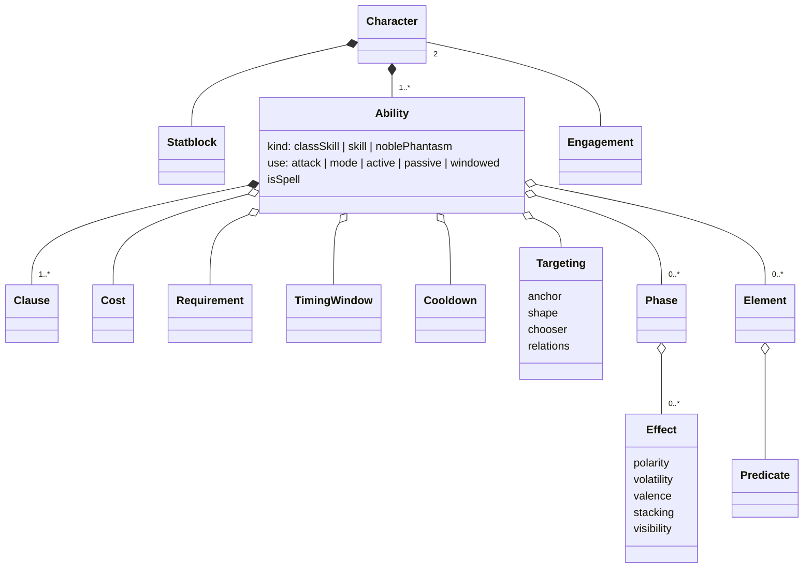

# The Character model

What a Character Sheet is made of, written as a set of **Shapes**: the kinds of thing every sheet is built
from, each with its fields and the values those fields take. It is the map a new Servant's design starts
from: find each Clause's Shape here, and the code that already runs it.

The model grows by survey (`.claude/skills/survey-class`), one Class at a time, over all 469 sheets the
roster's Drive folders held on 2026-10-21 (`char_orig_sheets/by-class/`). A survey reads the sheets'
Clauses in **Kin** groups (`tools/sheet-kin.mjs`), gives each group a verdict, and lands the verdicts here.

## Verdicts

| Verdict | Means | Lands |
|---|---|---|
| **Member** | The Clause is a known Shape with known values. | `ledger.json` only |
| **Variant** | A known field takes a new value: a targeting shape the code lacks. | the Shape's file, a new row |
| **Attribute** | A known Shape gains a field: abilities that turn out to have modes. | the Shape's file, a new field |
| **Shape** | A new kind of thing. | a new file here |
| **Own** | One sheet's rule, shared with nobody: it binds only its owner. | `ledger.json` only |

A Variant, Attribute or Shape the engine cannot yet run becomes an issue. A Shape's own file holds what the
surveys found: [ability.md](ability.md), [cooldown.md](cooldown.md), [element.md](element.md),
[engagement.md](engagement.md), [predicate.md](predicate.md), [statblock.md](statblock.md), [summon.md](summon.md), [character.md](character.md), [environment.md](environment.md), [bounded-field.md](bounded-field.md), [effect.md](effect.md), [identity.md](identity.md), [action.md](action.md), [reaction.md](reaction.md), [item.md](item.md).

Every verdict comes from reading the group in full, Members included.

## The Shapes the code already knows

The seed, read from the code on 2026-10-21. Each survey confirms, extends or splits these.

| Shape | What it is | Known values | Code |
|---|---|---|---|
| Engagement | Two Units fighting each other over time. New, Saber. | | none, [engagement.md](engagement.md) |
| Character | A sheet's Unit: Servant, and any summon or partner it states. | | `module/data/actor/` |
| Statblock | Parameters, Attributes, Health, MOV, Range, Base Attack. | | `module/data/actor/` |
| Ability | A named rule set on the sheet. | kinds: `classSkill` `skill` `noblePhantasm`. uses: `attack` `mode` `active` `passive` `windowed` | `rules/authoring/ability.mjs`, `rules/ability-use.mjs` |
| Clause | One rule a sheet states. | | `tools/lib/clauses.mjs` |
| Cost | What a use pays, and who pays it. | | `rules/costs.mjs` |
| Requirement | A condition a use must meet. | 30, from `inZon` to `withinPlatformCentre` | `rules/authoring/requirements.mjs` |
| Timing Window | When a use may happen. | `ownTurn` `whenAttacked` `whenAllyAttacked` `damageStep` `combatPhaseStart` `defendingPhaseStart` `whenTargetedByNP` `whenFatallyHit` `automatic` | `rules/windows.mjs` |
| Cooldown | How long until the next use. | `max`, `countFrom`, `branches`, `conditionalBonus` | `engine/cooldown.mjs` |
| Targeting | Who or where a use reaches. | 12 anchors, 12 shapes, choosers `all` `nearest` `random` `chosen` | `rules/targeting/vocabulary.mjs` |
| Phase | One step a use runs. | 26, from `applyEffects` to `cutContract` | `rules/authoring/phases.mjs` |
| Element | A standing rule an Ability or Effect carries. | 69, from `DamageModifier` to `Script` | `rules/authoring/elements.mjs` |
| Effect | A buff, debuff or status on a Unit. | the axes in Ch. 14 | `rules/registry.mjs`, Appendix A |
| Predicate | A condition an Element or Phase is gated on. | | `rules/predicate.mjs` |

## Progress

| Class | Sheets | Clauses | Surveyed |
|---|---|---|---|
| Saber | 58 | 2391 | 2026-10-21, read in full: 983 groups. 841 Member, 32 Own, 1 Shape, 4 Attributes, 5 Variants |
| Caster | 57 | 2449 | 2026-10-21, read in full: 976 new groups. 897 Member, 46 Own, 11 Variants, 4 Attributes |
| Archer | 52 | 2025 | 2026-10-21, read in full: 690 new groups. 663 Member, 8 Own, 1 new Variant |
| Lancer | 52 | 1954 | 2026-10-21, read in full: 582 new groups. 489 Member, 27 Own, 2 new Variants, 2 new Attributes |
| Rider | 52 | 2360 | 2026-10-21, read in full: 762 new groups. 717 Member, 17 Own, 2 new Variants |
| Berserker | 50 | 1850 | 2026-10-21, read in full: 532 new groups. 497 Member, 21 Own, 1 new Variant, 1 new Attribute |
| Assassin | 45 | 1919 | 2026-10-21, read in full: 580 new groups. 539 Member, 1 Own, 40 on known Variants and Attributes, nothing new |
| Ruler | 20 | 793 | 2026-10-21, read in full: 233 new groups. 217 Member, 3 Own, 13 on known Variants and Attributes, nothing new |
| Alter Ego | 18 | 780 | 2026-10-21, read in full: 230 new groups. 200 Member, 16 Own, 14 on known Variants and Attributes, nothing new |
| Avenger | 17 | 590 | 2026-10-21, read in full: 214 new groups. 198 Member, 8 Own, 8 on known Variants and Attributes, nothing new |
| Foreigner | 16 | 639 | 2026-10-21, read in full: 197 new groups. 179 Member, 0 Own, 1 new Variant, 17 on known Variants and Attributes |
| Pretender | 12 | 570 | 2026-10-21, read in full: 176 new groups. 143 Member, 14 Own, 19 on known Variants and Attributes, nothing new |
| Mooncancer | 9 | 358 | 2026-10-21, read in full: 118 new groups. 97 Member, 15 Own, 6 on known Variants and Attributes, nothing new |
| Beast | 8 | 347 | 2026-10-21, read in full: 92 new groups. 87 Member, 1 Own, 4 on known Variants and Attributes, nothing new |
| Shielder | 2 | 58 | 2026-10-21, read in full: 13 new groups. 13 Member, nothing new |

All 15 Classes, 469 sheets, were surveyed by 2026-10-21. Each engine gap they found is an issue, #281 to #311.
